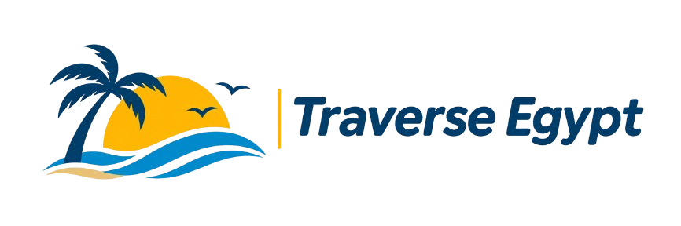

# Traverse Egypt 🇪🇬 ✦ Luxury Pharaonic Expeditions

A modern, high-end tourism web application for **Traverse Egypt**, crafted with React, Vite, Tailwind CSS, and Three.js 3D elements inspired by the official brand logo.



## 🌟 Highlights & Features

- **Interactive 3D Hero Section (Three.js)**:
  - 3D Great Pyramids of Giza with reflective golden apex caps (pyramidion).
  - Parametric desert sand dunes contouring to the waves in the brand logo.
  - Animated 3D radiant golden sun orb with dynamic atmospheric lighting.
  - 3D silhouette seagulls and swaying palm trees directly matching the logo emblem.
  - 1,000+ golden dust particles swirling on the Saharan breeze.
  - Interactive mouse tilt, parallax, and 3D camera orbit controls.
  - 3 Atmosphere Moods: *Golden Hour* (signature logo palette), *Oasis Noon*, and *Nile Dawn*.
  - Synthesized Egyptian desert breeze & oud harmonic sound generator powered by the Web Audio API.

- **Brand Identity & Luxury Light Theme**:
  - Alabaster and golden sand ivory backgrounds (`#fbf9f5`).
  - Deep Nile Navy (`#05233e`), Desert Sun Amber (`#f59e0b`), and Red Sea Azure (`#0284c7`).
  - Frosted glassmorphism navigation and cards.

- **Curated Expeditions**:
  - *The Grand Pharaoh's Odyssey* (10 Days, Giza VIP & Abu Simbel)
  - *Royal Dahabiya Nile Sanctuary* (8 Days, Silent Wind-Powered Sailing)
  - *Red Sea Azure Reefs & Sinai Oasis* (7 Days, Ras Mohammed & Dahab)
  - *Siwa Oasis & Great Sand Sea Mirage* (6 Days, Salt Lakes & Eco-Lodge)
  - *White Desert & Crystal Mountain Expedition* (4 Days, Glamping)
  - *Cairo Secret Alleys & Royal Treasures* (4 Days, GEM & NMEC)

- **Interactive Tools & Utilities**:
  - **Quick Discovery Filter**: Fast search by destination, style, duration, and party size.
  - **Multi-Currency Converter**: Real-time pricing in **USD ($)**, **EUR (€)**, **GBP (£)**, and **EGP (E£)**.
  - **Interactive Egypt Regional Map**: Clickable pins with live weather, coordinates, and regional highlights.
  - **Custom Tour Builder ("Design Your Traverse")**: 4-step bespoke itinerary architect with live calculated estimate.
  - **Full Day-by-Day Modal**: Detailed daily schedules, accommodations, meals, and inclusions/exclusions.
  - **Reservation & Printable Voucher**: Multi-step booking checkout with confetti and printable confirmation receipt (`#TE-XXXXXX`).
  - **Live Visa Requirements Checker**: Real-time visa rules for USA, UK, EU, Canada, Australia, GCC, and more.
  - **24/7 Egyptologist Concierge**: Interactive chat assistant (*Dr. Amina*).
  - **Saved Wishlist Drawer**: Persistent locally stored trip favorites.

## 🚀 Quick Start

### Prerequisites
- Node.js (v18+ recommended)
- npm or yarn

### Installation

```bash
# Clone the repository
git clone https://github.com/Mon200004/traverse-egypt.git

# Navigate into directory
cd traverse-egypt

# Install dependencies
npm install

# Run development server
npm run dev
```

Open `http://localhost:5173/` in your browser.

### Production Build

```bash
npm run build
npm run preview
```

## 🛠️ Built With

- **React 18**
- **Vite**
- **Tailwind CSS**
- **Three.js** (WebGL 3D Hero Scene)
- **Lucide Icons**
- **Canvas Confetti**
- **Web Audio API**

---
© 2026 Traverse Egypt. Ministry of Tourism & Antiquities License #A-8942.
